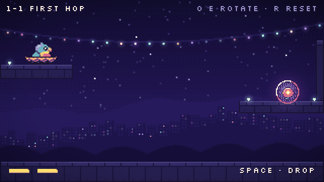
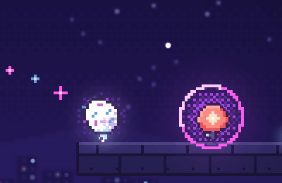
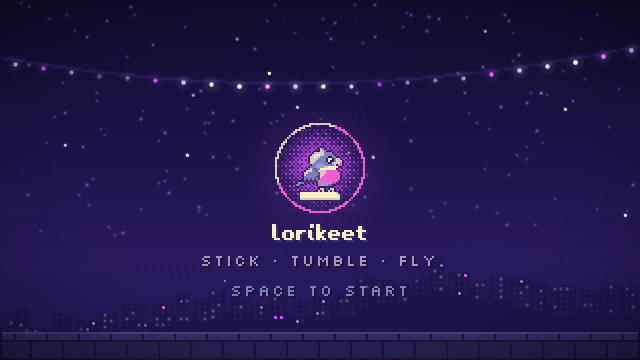

<div align="center">

<h1>Lorikeet</h1>

**Stick a note on the wall. Watch it become the game.**

A projector, a webcam and a pad of Post-its turn any wall or table into a game you play with your hands.

<br />

[](docs/adr/0002-python-desktop-stack.md)
[](https://pyga.me)
[](https://www.pymunk.org)
[](docs/adr/0006-classical-color-detection.md)
[](LICENSE)
[](docs/ROADMAP.md)

</div>



> **Where it's at:** the puzzle runs on screen today, with the mouse standing in for the camera. Projector calibration and note detection come in Phases 1–2. [The roadmap](docs/ROADMAP.md) tracks what's real.

---

## The Problem

Video games live behind glass. Even "physical" games mean a controller, a phone, or a camera that tracks your body. None of them read the world around you. There's no easy way to make a wall or a table *be* the game, where moving a real object changes the level.

**Lorikeet fixes that.**

A projector paints the game onto a surface. A webcam watches it. Every sticky note you put up becomes part of the game: a ramp, a wall, a spring, a tower. Move a note and the game reacts, right where your hand is.

---

## What It Looks Like

<table>
<tr>
<td width="50%"></td>
<td width="50%"></td>
</tr>
<tr>
<td><b>Reach the nectar.</b> It draws the egg in, a shield closes around it, and a chick hatches.</td>
<td><b>Miss, and learn.</b> The egg splats, and its path stays on screen so you can plan the next try.</td>
</tr>
</table>

---

## How It Works — In 60 Seconds

```
1. Plug in a projector as an extended display and point a webcam at the wall
2. Run Lorikeet: it projects four markers and learns where the camera is looking
3. Stick Post-its anywhere on the projection
4. Lorikeet finds every note and hands it to the game, in projector pixels
5. The game draws right on and around your notes
6. Move a note, and the game reacts
```

---

## Two Ways to Play

| Mode | A note becomes… | Built for |
|---|---|---|
| **Bodies** | a solid shape with physics | puzzles and platformers, like the egg-and-nectar puzzle |
| **Selections** | a click on a grid | strategy and tower defense: place a note to build, peel it off to sell |

Games only ever see notes through one small interface ([ADR 0004](docs/adr/0004-games-see-only-the-interface.md)), so a new game gets real sticky-note input without touching any computer vision.

---

## The Puzzle

- **Lori and the egg.** Lori can't fly yet. She stays in her nest and pops out an egg, and you build its path.
- **Sun notes spring.** The egg bounces off a note's face, and the harder it lands, the faster it leaves.
- **Paper wears out.** Each note holds for two touches, then peels off and flutters away.
- **Splat or nectar.** Miss and the egg splats on the stones. Reach the blossom and something hatches.
- **A ghost of your last try.** The previous path stays on screen as a rainbow trail, with its bounces marked.
- **The same notes always give the same run.** The physics steps on a fixed clock, so a layout plays out identically every time.

---

## The Look

<p align="center"></p>

- **Night-garden pixel art.** A dithered indigo sky, a party on the hillside, string lights and magenta magic.
- **Chunky pixels, smooth motion.** Everything is drawn on a 320×180 board and scaled by whole numbers: ×4 in a window, ×6 on a 1080p projector. Moving things glide at your display's refresh rate, up to 120 Hz.
- **Soft light, real depth.** Glows breathe slowly over the pixel art, and the backdrop sits slightly out of focus behind the action.
- **Hand-placed sprites.** Every sprite is a character map in code. The art kit's scripts in [`tools/sprites`](tools/sprites) rebuild the shipped PNGs pixel for pixel.

---

## Built to Be Trusted

- **Camera frames never leave your machine.** No saving, logging or sending ([ADR 0007](docs/adr/0007-camera-frames-stay-local.md), [privacy](docs/legal/privacy.md)).
- **No people in any committed image:** fixtures, screenshots and this README.
- **Photosensitivity-safe.** Nothing flashes full-screen more than three times a second ([threat model](docs/security/threat-model.md)).
- **Runs on one laptop.** No server, no accounts, no network.

---

## Quickstart

```bash
brew install uv                                   # once: the Python toolchain
git clone https://github.com/mahirmugdho/lorikeet.git && cd lorikeet
make setup                                        # Python 3.13 + dependencies into .venv
make check                                        # format, lint, types, tests
uv run python -m lorikeet.games.puzzle            # play the puzzle (add --fps for a counter)
```

| Control | Does |
|---|---|
| **Space** | start, drop the egg, play again |
| **Drag** from the pad | place a note |
| **Q / E** or scroll | turn a note in 15° steps |
| **Right-click** | send a note back to the pad |
| **R** | back to building (in build mode: clear every note) |
| **Esc** | quit |

Full machine setup is in [docs/setup.md](docs/setup.md), and the hardware list is in [docs/BUY.md](docs/BUY.md).

---

## Tech Stack

Decided in [ADR 0002](docs/adr/0002-python-desktop-stack.md): one local Python process.

| Layer | Technology |
|---|---|
| Language | Python 3.13 with uv |
| Vision | OpenCV (headless): capture, ArUco calibration, colour detection |
| Physics | pymunk (Chipmunk2D) |
| Rendering | pygame-ce, fullscreen on the projector |
| Geometry | NumPy |
| Quality | pytest, ruff, pyright; the same `make check` runs in CI |

---

## Project Layout

```
src/lorikeet/
  geometry.py          camera → projector homography
  capture.py           webcam frames                          (Phase 1)
  calibration.py       ArUco markers → homography             (Phase 1)
  detection.py         HSV + contours → note polygons         (Phase 1)
  tracking.py          stable note ids, debounce              (Phase 2)
  interface.py         Note, Scene, SceneSource, modes        (Phase 2)
  games/puzzle/        the egg-and-nectar physics puzzle      (Phase 3)
  games/tower_defense/ selections mode                        (Phase 4)
tests/                 pytest, headless (no camera or display in CI)
tools/                 art kit sprite scripts, GIF recorder
docs/                  pitch, roadmap, ADRs, setup, testing, security, legal, media
```

---

## Roadmap

| Phase | Goal | Owner | Status |
|---|---|---|---|
| 0 | Scaffold: tooling, CI, docs, decisions | Ryan | Done |
| 1 | See the notes: capture, calibration, detection | Mahir | Next |
| 2 | Track notes, define the interface | Mahir | Planned |
| 3 | Puzzle game (bodies) | Ryan | Prototype in review |
| 4 | Tower defense (selections) | Ryan | Planned |
| 5 | Demo-ready: set up from the docs in under 30 minutes | Both | Planned |

The detail, and what counts as done, is in [docs/ROADMAP.md](docs/ROADMAP.md).

---

## Team

Ryan ([@RyanS2025](https://github.com/RyanS2025)) and Mahir ([@mahirmugdho](https://github.com/mahirmugdho)). Want to help? Start with [CONTRIBUTING.md](CONTRIBUTING.md).

---

<div align="center">

Made with sticky notes and starlight &nbsp;·&nbsp; [MIT](LICENSE) ([ADR 0003](docs/adr/0003-license.md))

</div>
